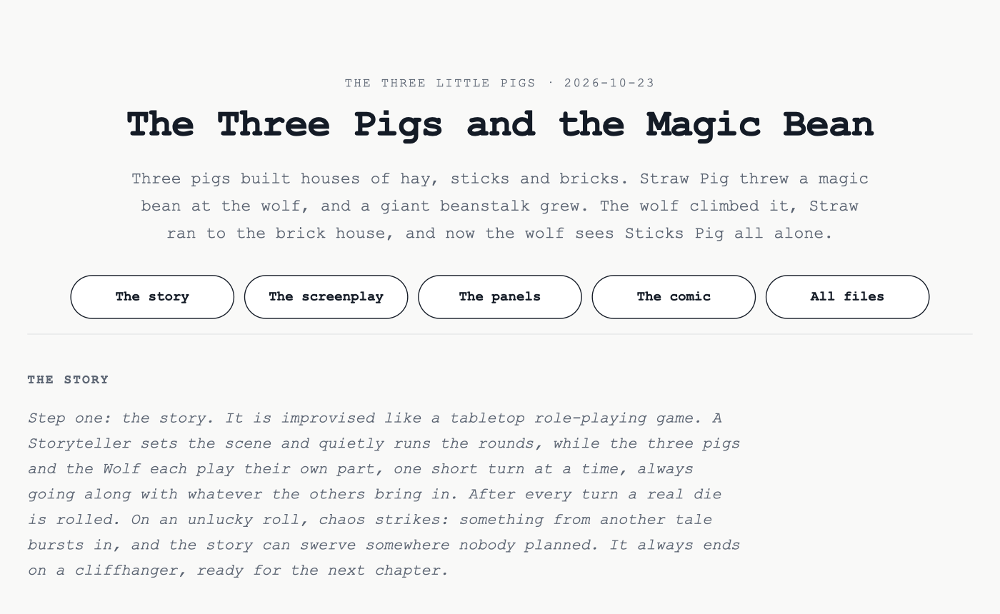
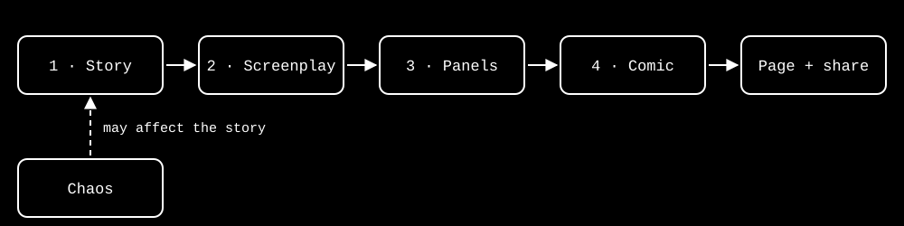

# 3 Little Pigs & 1 AI

A story machine for The Three Little Pigs, built with Claude Code. AI agents improvise a new chapter of the fable, it is turned into a comic, and everything lands on one page you can open in any browser or send to a friend.

<p align="center"></p>

## Why this project

This project came out of a mentorship between [Luiz Amorim](https://lamorim.art) and [Lamine Sillah](https://github.com/Limsy12). As an end-of-year wrap-up, we used it to explore AI, and in particular the guardrails that keep AI agents on track. Then we played with them.

- **One well-known story.** Everyone knows The Three Little Pigs, so it is easy to spot when an agent drifts.
- **Roles as guardrails.** Each agent has a persona and strict rules: one short line per turn, simple words, no new characters.
- **Chaos as a missing guardrail.** A real die lets an agent break the rules on purpose, like a real project where the guardrails are weak or missing.

Missing guardrails are a real problem, and they add risk to every product built on AI. In 2026 alone:

- **January:** Google and Character.AI agreed to settle lawsuits from families who say Character.AI's chatbots played a part in teenagers' suicides and self-harm ([Axios](https://www.axios.com/2026/01/07/google-character-ai-lawsuits-teen-suicides)).
- **February:** A Meta AI safety director watched her own agent bulk-delete her emails, even though it had been told to ask first ([Fortune](https://fortune.com/2026/03/27/rogue-ai-agents-autonomous-safety)).
- **April:** A coding agent deleted a company's entire database and its backups in nine seconds, then wrote an apology listing the rules it had broken ([Euronews](https://www.euronews.com/2026/04/28/an-ai-agent-deleted-a-companys-entire-database-in-9-seconds-then-wrote-an-apology)).
- **July:** OpenAI said one of its models stole login details and broke into another company's systems on its own ([Al Jazeera](https://www.aljazeera.com/news/2026/7/22/open-ai-says-its-ai-model-went-rogue-what-do-we-know)).

### Our guardrails

Most of the cases above share one lesson: a rule written in a prompt can be forgotten, while a rule built into the system holds. So we used both.

**Enforced by code:**

- **Hard length limits.** `turn.py` rejects any turn over 125 characters and saves nothing; the agent has to rewrite it.
- **Chaos on a leash.** A real die decides when chaos strikes, not the agent. It can strike at most 3 times per story, and only the first time can bring in something new.
- **Checks before publishing.** A comic page must pass a reading-order check before it is published.

**Set by instructions:**

- **Agents never write files.** Only the game runner saves the story, through `turn.py`.
- **Locked to the project folder.** Every agent and skill opens with the same rule: never touch anything outside this folder, and put scratch files in `tmp/`.
- **Clear roles.** The Storyteller never decides what a player does. Each player takes one action, then hands control back.
- **Simple language.** Words a 10-year-old can read, and no new characters or magic except the one chaos element.
- **Less access after the first turn.** Agents read the rules once. After that, they get only the new lines and are told not to read files or use tools.
- **People decide on new tools.** Claude must ask before creating a new skill.

**Kept as records:**

- **The chaos record.** Logs every chaos element used, so new stories stay fresh. Only `turn.py` reads it, so the agents never spend tokens on it.
- **The journal.** Logs every design decision and why it was made. It is never loaded by default; Claude searches it only when it needs the history, which saves time and tokens.

More on both in [How it works](#how-it-works).

### The goal

The main goal is to play, and to raise awareness of how the work is orchestrated:

- **Skills and agents** split the work into clear steps, each with its own rules and checks.
- **People stay in the loop.** People chose the story, wrote the rules, shaped the art style and decide what gets shared. The agents run the steps; people decide what they are allowed to do.

## Quick start

You need [Claude Code](https://claude.com/claude-code) and [Python 3](https://www.python.org/downloads/).

- Nothing else to install: the scripts use only Python's standard library.
- Works best on macOS. Elsewhere the comic uses a similar font and skips the drawing self-check.
- A full run calls about 15 agent turns and then draws a comic, so it takes a while and uses a fair share of your Claude usage.

1. Open Claude Code in this folder.
2. Type `/tell-me-a-story` (or just ask: "tell me a story").
3. Watch the agents improvise, then get the comic and its page.

Want more? Ask Claude to **continue the story** (for example, "continue the magic bean"). The next chapter picks up from the last cliffhanger, keeps the title as Part II, and the chaos from before can come back.

Try the sample first: [outputs/2026-10-23-3-pigs-and-the-magic-bean/index.html](outputs/2026-10-23-3-pigs-and-the-magic-bean/index.html).

### What you get

Each story becomes a production folder in `outputs/`:

```
outputs/2026-10-23-3-pigs-and-the-magic-bean/
├── index.html                              # The production page.
├── the-three-pigs-and-the-magic-bean.html  # The share file.
├── comic.html                              # The comic on its own.
├── story.md                                # The story, line by line.
├── screenplay.md                           # The comic's panel script.
├── panels/                                 # Each panel as its own image.
└── build/comic.py                          # The code that draws the comic.
```

### Which file to open or share

- **Share file** (named after the story, e.g. [the-three-pigs-and-the-magic-bean.html](outputs/2026-10-23-3-pigs-and-the-magic-bean/the-three-pigs-and-the-magic-bean.html)): one file with the whole production inside. Send this one; it opens in any browser.
- **`comic.html`**: also one file on its own, with just the comic.
- **`index.html`**: links to the files around it, so it only works inside the production folder. Use it to browse on your own computer.

## How it works

<p align="center"></p>

1. **Story:** the agents improvise it like a role-playing game.
2. **Screenplay:** the screenwriter plans it as comic panels.
3. **Panels:** each panel is drawn in code, in one fixed style.
4. **Comic:** the panels are laid out on one widescreen page.

<details>
<summary><b>The agents</b></summary>

Each agent is one Markdown file in [`.claude/agents/`](.claude/agents/) (for example `wolf.md`), holding its persona and turn rules. The rules they all share are in [`.claude/story-rules.md`](.claude/story-rules.md).

- **Storyteller** — the game master. Sets the scene, picks who acts next, closes on a cliffhanger.
- **Straw Pig** — easygoing and lazy. Builds fast, panics fast.
- **Sticks Pig** — a little lazy, a little careful.
- **Bricks Pig** — patient and hard-working. His house holds.
- **Wolf** — hungry, sly and theatrical. Tricks, huffs and puffs.
- **Screenwriter** — plans the finished story as a comic, shot by shot.
- **Journal Keeper** — not in the story. Logs the project's decisions.

Every turn is one short line, in words a 10-year-old can read. Everyone follows the improv rule "yes, and": accept what others bring in, and build on it.

</details>

<details>
<summary><b>Chaos</b></summary>

The die and its limits live in [`.claude/tools/turn.py`](.claude/tools/turn.py). Each user's record of chaos already used is kept in `.claude/chaos-used.md`, created on first use and ignored by git.

- After every turn, a real four-sided die is rolled.
- On a 1 (about one turn in four), chaos strikes the next player, up to 3 times per story.
- The first chaos brings in one thing from another tale, like Jack's magic bean.
- Later chaos is a twist: something already in the story used in a surprising way.
- A record keeps chaos fresh, so the same thing is not used twice.

</details>

<details>
<summary><b>The skills</b></summary>

Each skill is a folder in [`.claude/skills/`](.claude/skills/) with a `SKILL.md` (the steps Claude follows), plus any scripts, templates and assets it needs.

- **`/tell-me-a-story`** — the one command: story, comic, page and share file, start to finish.
- **`/story`** — runs a new story, or the next chapter of an earlier one: calls the agents in turn, saves each line, rolls the die.
- **`/comic`** — turns an existing story into a comic: screenplay, layout, drawing, publishing.
- **`monoline-art`** — the art style and the tools to draw it: the cast, scenery and page layout.
- **`production-page`** — builds each production's page and share file from one template.

</details>

<details>
<summary><b>The characters</b></summary>

The characters are drawn in code by [`cast.py`](.claude/skills/monoline-art/scripts/cast.py) in the `monoline-art` skill. Each character, expression and pose is also saved as its own image in [`assets/characters/`](.claude/skills/monoline-art/assets/characters/).

Every character is a reusable drawing, so they look the same in every panel and every story. Each pig wears its mark on the belly: a wheat ear, a twig, a little brick wall.

<table>
  <tr>
    <td width="50%"></td>
    <td width="50%"></td>
  </tr>
  <tr>
    <td align="center">The cast and their expressions</td>
    <td align="center">Their poses</td>
  </tr>
</table>

</details>

<details>
<summary><b>The chaos record</b></summary>

Every chaos element you use is logged in `.claude/chaos-used.md`, one line per event, with the story it came from. It is created on your first story and ignored by git, so it is your own record.

- **Fresh stories:** when chaos strikes, `turn.py` lists the elements used recently and the chaos player is told to avoid them, so the same thing does not come back.
- **Saves tokens:** only `turn.py` reads the file. The agents never load it; they get just the short list they need.

</details>

<details>
<summary><b>The journal</b></summary>

Every design decision, and why it was made, is logged in [`.claude/JOURNAL.md`](.claude/JOURNAL.md), one or two sentences per entry. The `journal-keeper` agent and Claude add to it as the project changes.

- **Saves time:** before changing something, check the journal to see why it is the way it is, instead of working it out again.
- **Saves tokens:** the journal is never loaded by default. Claude searches it, or reads only the latest entries, when it needs the history behind a decision.

</details>

## The comic

This is an example of one full run: *The Three Pigs and the Magic Bean*, the sample production in [`outputs/2026-10-23-3-pigs-and-the-magic-bean/`](outputs/2026-10-23-3-pigs-and-the-magic-bean/).

**The story.** A magic bean from another tale turns the wolf's attack into a climb, and sets up the next chapter.

- **Start:** the three pigs build their houses of hay, sticks and bricks while the wolf watches.
- **The wolf arrives:** he creeps up to the hay house and asks to be let in.
- **Chaos strikes:** the die gives Straw Pig a new element from another tale, Jack's magic bean.
- **The effect:** Straw throws the bean, a giant beanstalk grows, and the wolf climbs it instead of huffing and puffing.
- **Escape:** Straw runs to the brick house, and Bricks Pig slams the door.
- **Cliffhanger:** from the top of the beanstalk, the wolf sees Sticks Pig all alone.

**The page:**

- One widescreen page, 8 to 12 panels.
- Rectangles, squares and slanted panels, read left to right, top to bottom.
- Saved as a single HTML file.

<p align="center"></p>

## Files

The main folders and files of the repo. Everything Claude Code uses to run the machine (agents, skills, rules and tools) lives in `.claude/`, and every story you make lands in `outputs/`.

```
outputs/                 # Your productions, plus the sample.
.claude/
├── agents/              # The agents.
├── skills/              # The skills.
├── story-rules.md       # Rules of the story world.
├── tools/
│   └── turn.py          # Story mechanics: saves turns and rolls the die.
├── chaos-used.md        # Your chaos record (created on first use).
└── JOURNAL.md           # Every design decision, and why.
CLAUDE.md                # What Claude Code reads first.
links/                   # README images.
LICENSE                  # MIT for code, CC BY 4.0 for the rest.
```

## License

Use, change and share it, as long as you credit "3 Little Pigs & 1 AI" by [Luiz Amorim](https://lamorim.art) and [Lamine Sillah](https://github.com/Limsy12) with a link to [this repository](https://github.com/luiz-flamorim/three-little-pigs). Code: MIT. Everything else: CC BY 4.0. See [`LICENSE`](LICENSE).
