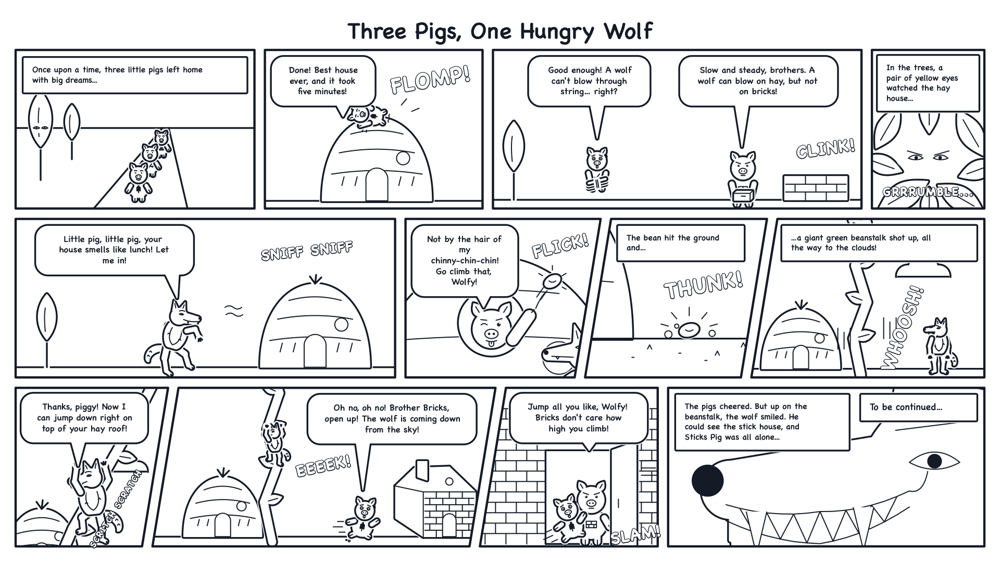
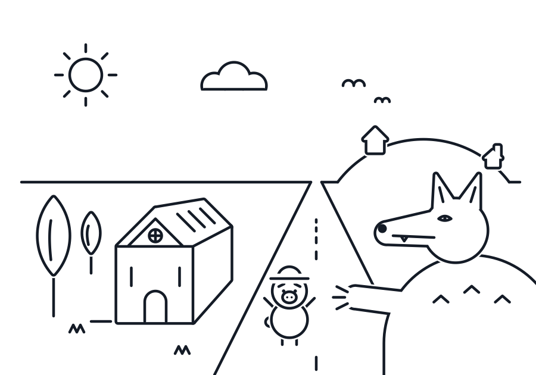
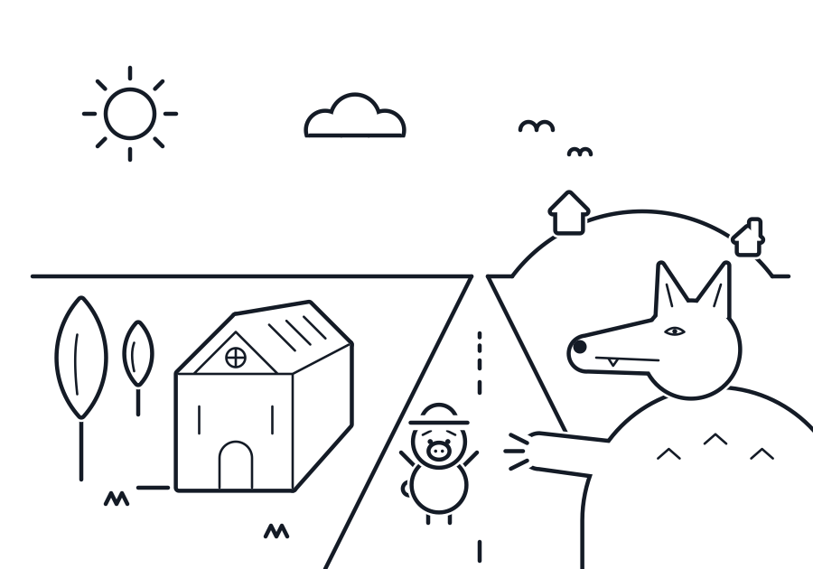
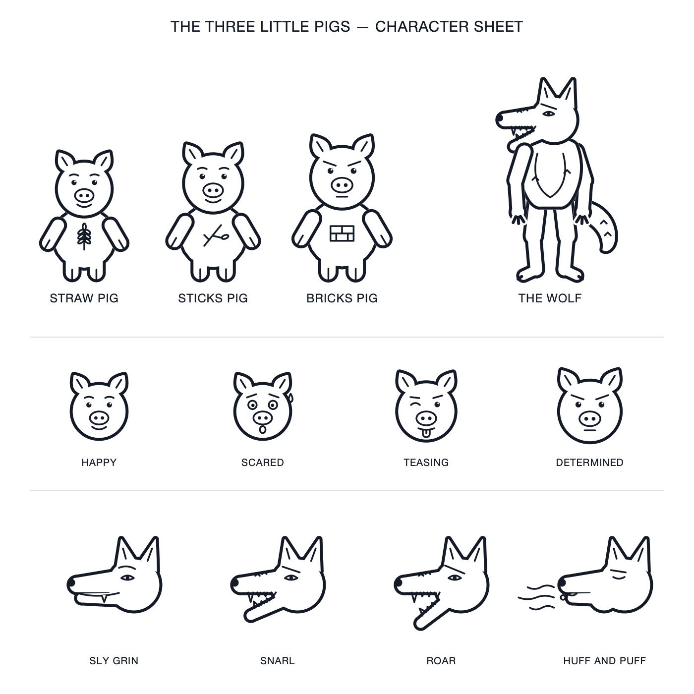
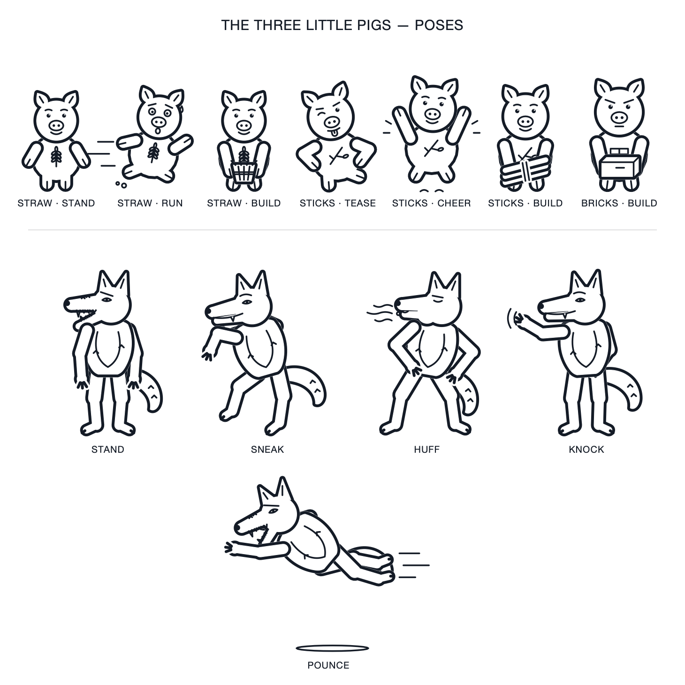

# 3 Little Pigs — A

A story machine for The Three Little Pigs, built with Claude Code. A small cast of AI agents improvises a brand-new chapter of the fable together, each playing its own character, and then a screenwriter agent and a drawing toolkit turn the story into a one-page comic you can open in any browser.

This project is the final piece of a mentorship programme. It was built to test and show how LLM-based agents interact with one another, each holding its own persona, inside a shared story.

## Quick start

You need [Claude Code](https://claude.com/claude-code) and Python 3 (no extra packages).

1. Download or clone this repository and open Claude Code in its folder.
2. Type `/story`. The agents improvise a new story, and you watch it appear in the terminal turn by turn.
3. Type `/comic`. The story is planned as comic panels, drawn, and published.

Each story becomes a production: a folder in `outputs/`, named by its date and title (for example `outputs/2026-10-23-3-pigs-and-the-magic-bean/`), holding everything made from it. Open its `index.html` in your browser: one page presents the whole production, with the comic, the panels, the story and the screenplay, and a button for each. A title used before becomes Part II, Part III and so on.

To share a production, send its share file to your friends: it is named after the story (for example `the-three-pigs-and-the-magic-bean.html`), sits in the production's folder, and holds the whole production in a single file that opens in any browser.

## How the story works

The Storyteller agent acts as a game master in the background, and the three pigs and the Wolf act as players, much like a tabletop RPG. The Storyteller opens the story with one short line, then runs the rounds: after each player's turn it picks who acts next, usually without saying anything, and it speaks only now and then to switch scenes or fold in a chaos element. It closes the story on a cliffhanger to make readers curious about the next chapter, and then writes a short summary. The Storyteller never decides what a pig or the Wolf does; players only interact with others who are nearby; and every agent follows the improvisational "yes-and" rule, accepting whatever another agent brings into the story.

Stories are short and simple: at most 12 parts, with every pig and the Wolf acting at least once. Every turn is one line of up to 125 characters, and everything is written so a 10-year-old can read it.

To add some chaos, a real die is rolled after each turn. On a 1 (at most three times per story), the next player gets a chaos turn. The first one brings in a single element from another story, such as Cinderella's glass slipper, something not used in earlier stories; any later chaos turn is a twist that uses what is already in the story in a surprising way. Apart from that one element, nobody adds new characters or magic things, so the story stays easy to follow.

## How the comic works

A story is written to be read; a comic must be seen. So the `screenwriter` agent first plans the story as a comic, like a film director planning shots. It adds the in-between moments that make the action clear (if a pig throws a magic bean from his window, we see it fly, land, and grow), close-ups that add drama (the Wolf's eyes in the leaves), and big sound words (WHOOSH!, SLAM!). It keeps the words short, and it makes the last panel the most dramatic shot on the page, ending on the cliffhanger and "To be continued...".

Then the page is drawn and published:

- **One widescreen page.** The whole story fits one 16:9 page with 8 to 12 panels, in rectangles, squares and slanted shapes with an even gap between them.
- **Easy to read.** The page must read left to right, then top to bottom. A check makes sure the gaps between panels never line up from one row to the next, which would make the page look like columns.
- **One art style.** Everything is drawn in a monoline style: one dark navy ink, thick outlines and thinner details, built from circles, arcs and straight lines. The characters are reusable drawings, so they look the same in every panel.
- **Self-contained.** The comic is a single HTML file with nothing external, so it can be opened, shared or attached anywhere.

A sample production ships with the project: open `outputs/2026-10-23-3-pigs-and-the-magic-bean/index.html` in a browser.

## Making of the art

The comic art was found the same way the story rules were: by trying something, looking at it honestly, and fixing what did not work. Every drawing here is made by Claude writing SVG code, then rendering it to an image and looking at the result.

**1. Exploring styles.** The same test moment (the Wolf, the Straw Pig and the straw house) was drawn in many styles: a gothic storybook look, a surreal dream, stitched paper puppets, fine pen cross-hatching and blue ballpoint scribble (both from reference drawings), 1930s rubber hose cartoons, and a layered 2.5D look with fog and glowing light. Two lessons came out of it. Copying a reference's texture is not the same as drawing in its style; and Claude draws best when the style plays to code, with deliberate geometry instead of loose, painterly marks. Those drafts were scratch work and were not kept.

**2. Choosing monoline.** A simple reference of a potted plant, drawn with one even line, pointed the way. The first monoline test had real depth but messy lines that ran through each other. It was rebuilt on geometry: a grid, one vanishing point for the road and the house, shapes made only of circles, arcs and straight lines, and a thin white gap wherever one thing passes in front of another, so no line ever crosses another.

**3. Two line weights.** Thick outlines with thinner details inside the characters made the drawing easier to read: the shapes come first, and the faces, fur and windows second.

**4. The cast.** The characters were designed as reusable code, so every panel draws exactly the same pig or Wolf. The pigs share one body and each wears its mark on the belly: a wheat ear for straw, a twig for sticks, a little brick wall for bricks. The Wolf's jaw swings open on a hinge, with the teeth sized to fit, so his open mouth and fangs always read clearly.

**5. Poses.** The characters became simple puppets: each limb is a chain of joints, and the body can lean, lift off the ground and turn its head, so a new pose is just a few numbers. The pigs can run, carry their building material, tease with hands on hips and cheer; the Wolf can sneak on tiptoe, huff and puff, knock, climb and pounce.

**6. The first comic page.** The first comic was cut straight from the story's turns into 7 panels. It worked, but it taught two lessons. The gaps between panels lined up from one row to the next, so the page looked like columns and was read in the wrong order; now the gaps are staggered, and a check refuses to publish a page that would read out of order. And once drawn, some actions stopped making sense: the pig is inside his house, so how does he throw the bean, and when does he escape?

**7. A screenwriter.** That second lesson led to the `screenwriter` agent, which plans each comic before anything is drawn: the in-between beats, the close-ups, the sound words, and short text. The example page above was drawn from its 12-panel script, in 3 rows laid out by a search that keeps the reading order clear. Its first ending showed the cliffhanger in a calm, distant shot and fell flat, so the screenwriter now saves its most dramatic shot for last: here, an extreme close-up of the Wolf's toothy grin.

## Project structure

- `CLAUDE.md` — the entry point Claude Code loads automatically in every session. It opens with the project boundary rule, explains the project and its goal, lists the agents and skills, sets the conventions, and imports `.claude/story-rules.md` and `.claude/JOURNAL.md`.
- `.claude/story-rules.md` — the rules of the story world, read by every story agent on its first turn: the improv "yes-and" rule, how a story runs, turn and length limits, simple language, and chaos events.
- `.claude/agents/` — one markdown file per agent: `storyteller.md`, `pig-straw.md`, `pig-sticks.md`, `pig-bricks.md`, `wolf.md`, `screenwriter.md` and `journal-keeper.md`.
- `.claude/skills/` — the project skills: `story` runs a new story, `comic` turns a story into a comic page, `production-page` builds each production's page from one shared template (with a finished, self-sufficient example), and `monoline-art` holds the art style and everything needed to draw it: the drawing toolkit (`scripts/mono.py`), the cast (`scripts/cast.py`), scenery (`scripts/scenery.py`), the comic page tools (`scripts/comic.py`), the reference panel, character and poses sheets, and every character in every expression and pose (`assets/characters/`).
- `.claude/tools/turn.py` — runs the story's mechanics: creates the production folder, checks turn lengths, saves each turn and rolls the chaos die.
- `.claude/JOURNAL.md` — the author's plain-language log of the real decisions made while building this project, kept as project history and maintained by the `journal-keeper` agent. Story agents do not read it.
- `outputs/` — one folder per production, named `YYYY-MM-DD-3-pigs-and-<name>`: `index.html` (the production page), `story.md`, `screenplay.md`, `comic.html`, `panels/` and `build/` (the script that drew the comic). Your productions are ignored by git; the sample, `2026-10-23-3-pigs-and-the-magic-bean`, is part of the project.
- `.claude/chaos-used.md` — your record of the outside elements already used in chaos events, so new stories pick something fresh. Created on first use and ignored by git.
- `links/` — images used in this README.
- `LICENSE` — how you may use this project (see below).

## Status

Working, and still being refined. The story game has been tested in five stories and its rules refined after each one. The comic pipeline works end to end: the screenwriter, the layout, the drawing, the publishing and the production page were all tested on the sample production, though `/story` and `/comic` have not yet been run back to back in a fresh session.

Known limits:

- **Fonts.** The comic's lettering uses Chalkboard SE, which comes with macOS. On other systems the browser picks a similar font, and text may fit its bubbles less neatly.
- **Self-check.** While making a comic, Claude renders the page to an image and checks it. That step uses a previewer built into macOS; on other systems the comic is still made, but without the visual check.
- **What the art kit can draw.** The cast, houses, trees, clouds and a beanstalk are ready. A story that needs something new (a house blown down, an inside view, a character from another story brought in by chaos) is drawn on the spot with the same toolkit, and may look rougher.
- **Chapters.** Every story ends on a cliffhanger, but the next story does not yet continue from it; each one starts fresh.

## Next steps

- Run `/story` and `/comic` back to back in a fresh session, and fix what breaks.
- Embed a free font in the comic, so it looks the same on every system.
- Let `/story` continue from the last story's cliffhanger, so the chapters connect.
- Grow the art kit: houses blown down, inside views, night scenes.

## License

You are welcome to use, change and share this project, as long as you credit it: say that your work uses or is based on "3 Little Pigs — A" by Luiz Amorim, and link to this repository. The code is under the MIT License, and everything else (stories, drawings, comics, agent and skill instructions, documentation) is under Creative Commons Attribution 4.0 (CC BY 4.0). See `LICENSE` for the details.
